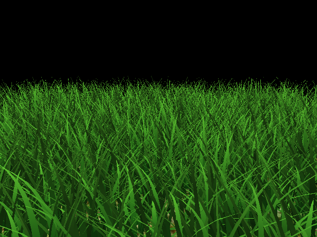
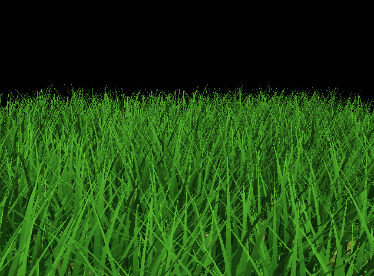
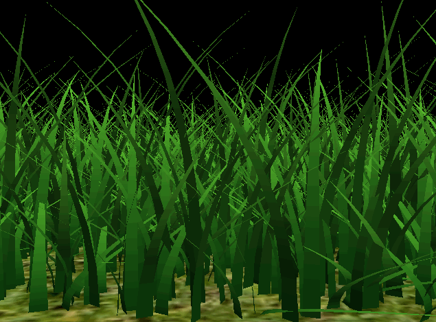
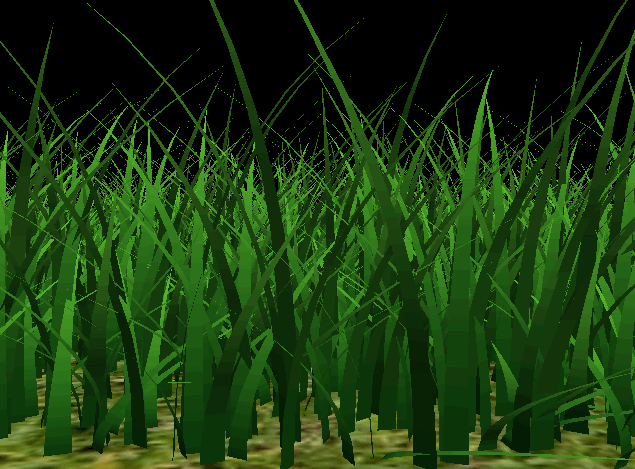

Vulkan Grass Rendering
==================================

**University of Pennsylvania, CIS 565: GPU Programming and Architecture, Project 5**

* Anna Dai [LinkedIn](www.linkedin.com/in/nanru-dai-8b33a9261) [Portfolio](https://annaaaddddd.github.io/)
* Tested on: Windows 11, AMD Ryzen 9 5950X @ 3.40GHz 128GB, RTX 3090 Ti (Personal Desktop)

## Overview

A real-time grass simulator and renderer written in Vulkan, based on [Responsive Real-Time Grass Rendering for General 3D Scenes](https://www.cg.tuwien.ac.at/research/publications/2017/JAHRMANN-2017-RRTG/JAHRMANN-2017-RRTG-draft.pdf). Each blade is a Bezier curve that is simulated in a compute shader and tessellated into geometry in the graphics pipeline.

## Features

### Tessellated Grass Blades

Blades rendered from their Bezier control points, with no forces applied.

### Physics Simulation

Gravity, recovery, and wind forces applied in the compute shader.

### Culling

(TODO)

## Performance Analysis

(TODO)
